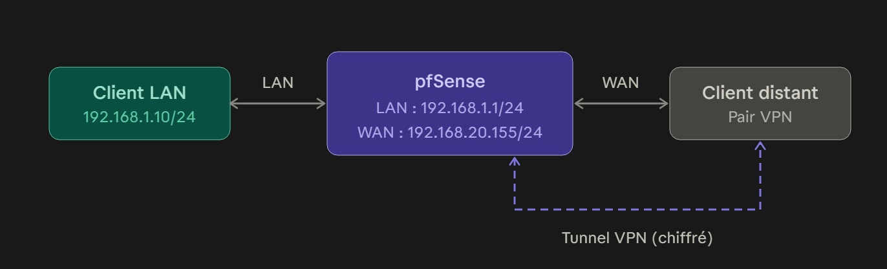

# VPN - OpenVPN

Loïc Mouthuy

BTS SIO

<aside>

# Sommaire

</aside>

<aside>

# Schéma réseau

</aside>

<aside>

# Mise en place du VPN

</aside>

<aside>

## Mise en place de l-autorité de certification

</aside>

Pour commencer il faut crée une autorité de certification, qui va attester que les certificat fournit sont bien valide. Ici c’est PfSense qui va certifier ses propres certificat (certificat auto-signé).

Pour cela il faut se rendre dans le menu des certificat :

Puis ajouter une autorité de certification dans Authorities :

Et nous arrivons sur le menu de configuration de cette nouvelle autorité de certification ou nous allons modifier uniquement le nom et laisser toute les informations restantes par défaut puis sauvegarder :

On voit bien cette nouvelle autorité de certification apparaître dans la liste :

<aside>

## Mise en place de certificat

</aside>

Nous allons maintenant crée un certificat pour le serveur VPN.

Nous allons donc maintenant nous rendre dans l’onglet Certificates puis ajouter un certificat :

Nous arrivons donc sur le menu de configuration du certificat que nous créons et ici il faut lui donner un nom :

Lui assigner l’autorité de certificat que nous venons de crée :

Et il ne faut pas oublier de modifier le type de certificat et de le mettre sur certificat de serveur :

<aside>

## Ajout d’un utilisateur

</aside>

Nous allons maintenant crée un utilisateur pour ce VPN qui va nous permettre de se connecter au VPN par la suite.

Pour cela on se rend dans l’onglet User Manager :

Puis nous allons crée un nouvel utilisateur :

Une fois dans le menu de configuration du nouvel utilisateur, nous allons d’abord lui attribué un nom d’utilisateur et un mot de passe :

Puis nous lui créons un certificat d’utilisateur :

Cela va nous ouvrir une nouvel page de configuration pour ce certificat d’utilisateur ou nous allons uniquement ajouter le nom de ce nouveau certificat et laisser les autres informations par défaut :

Et nous avons donc nos deux certificat crée dans l’onglet Certificates :

<aside>

## Configuration d’OpenVPN

</aside>

Pour configurer OpenVPN, il faut d’abord aller dans l’onglet Open VPN :

Nous allons utiliser le Wizard qui va préremplir quelque informations pour nous :

Puis nous suivons les étapes, dans un premier temp nous choisissons le type de serveur, ici un serveur ou nous utilisons la base de données local (utilisateur vpnuser) :

Nous choisissons l’autorité de certification que nous avons crée précédemment :

Puis nous choisissons le certificat serveur également crée précédemment :

Puis nous allons saisir les informations du VPN, tout d’abord son nom :

Nous laissons les protocol, port et authentification par défaut puis nous allons paramétré le tunnel. D’abord il faut configurer le réseau virtuel du tunnel, le tunnel doit utiliser un réseau virtuel différent de tout mes réseau existants :

Puis il faut indiquer le réseau auquel le client VPN doit accéder, cet à dire mon LAN (192.168.1.0/24) :

Enfin on vient indiquer un nom de domaine dns et une adresse IP de serveur DNS :

C’est maintenant que le Wizard est intéressant car il va permettre de cré deux règles, une qui va permettre la connexion au serveur OpenVPN depuis l’extérieur et une qui va permettre au client de passer à travers le tunnel :

Puis nous terminons :

<aside>

## Configuration du client

</aside>

Avant toute chose il faudra se rendre dans l’onglet Package Manager :

Pour pouvoir y installer openvpn-client-export :

Une fois installer nous pouvons voir apparaitre Client Export dans l’onglet OpenVPN :

Une fois dans cet onglet Client Export nous pourront descendre et voir les client autoriser à acceder au VPN et ou nous pourrons exporter un package installable pour le client :

<aside>

# Test client

</aside>

Après installation du package su rle client nous nous connectons avec les identifiant de l’utilisateur crée :

Le ping fonctionne bel est bien :

Et je peux me connecter à l’interface d’administration de PfSense :

